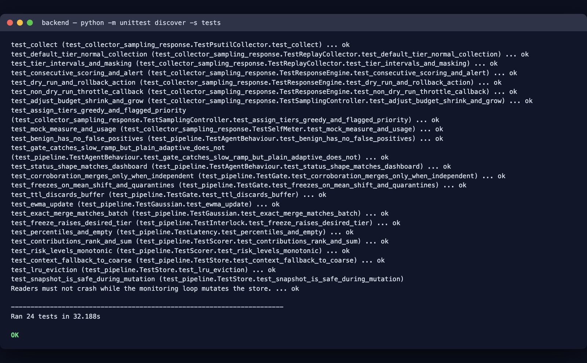
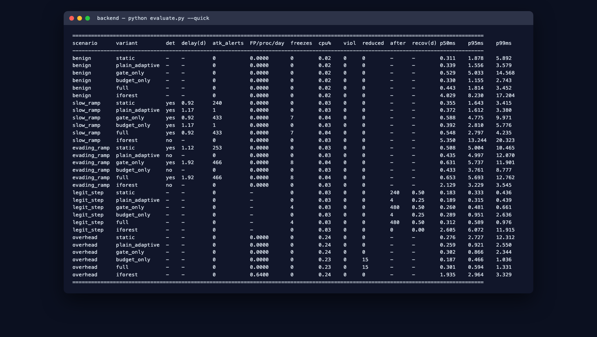
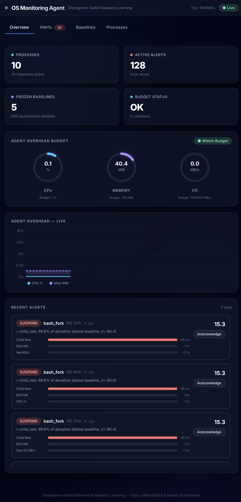
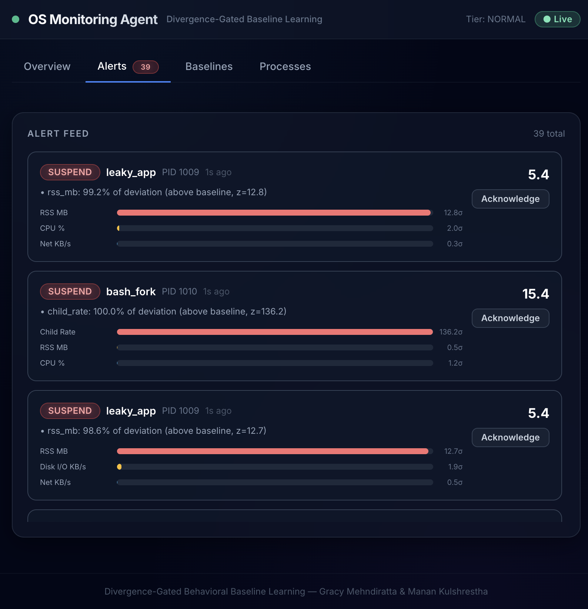
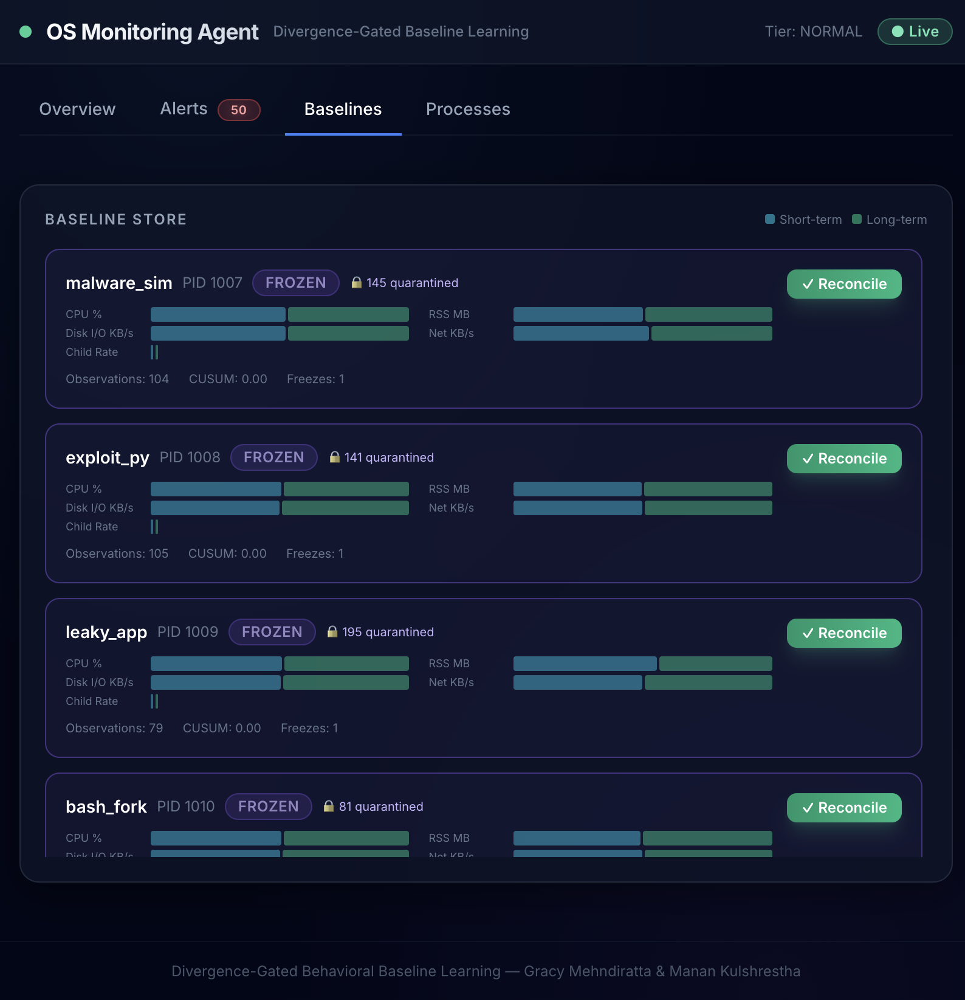
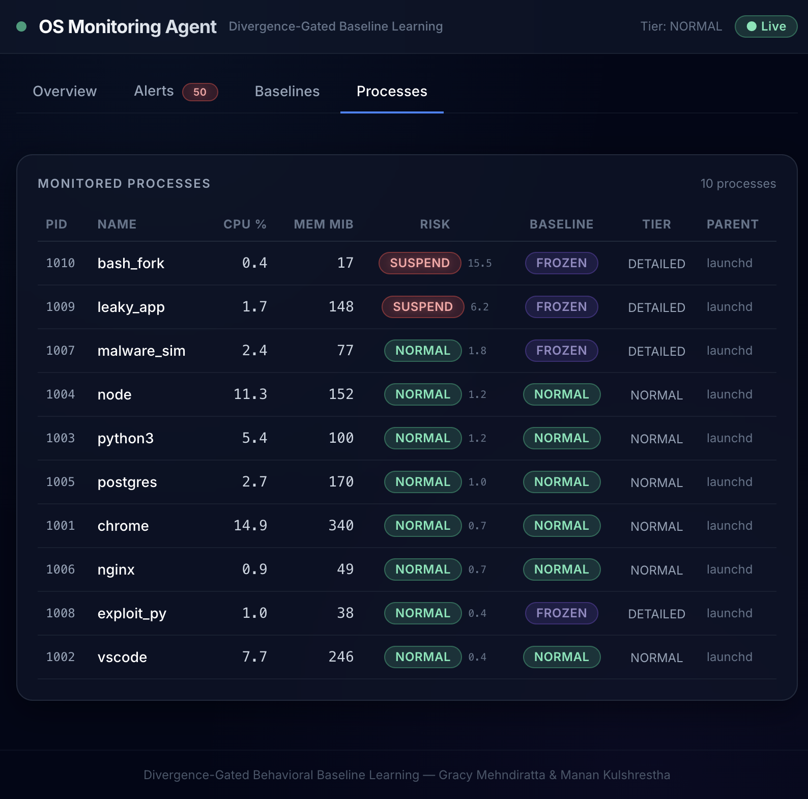
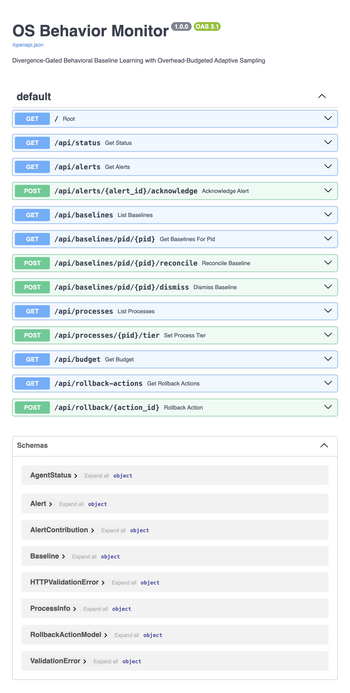

# OS Behavior Monitor

## Divergence-Gated Behavioral Baseline Learning with Overhead-Budgeted Adaptive Sampling

**Project Implementation Report — Review 2 / Review 3**

| | |
|---|---|
| **Course** | Operating Systems |
| **Team members** | Gracy Mehndiratta (24BCE2987), Manan Kulshrestha (24BCE0262) |
| **Roll numbers** | 24BCE2987, 24BCE0262 |
| **Repository** | https://github.com/gracymehndiratta/os-project |
| **Date** | October 2026 |
| **Document version** | 1.0 |

---

## Table of Contents

1. Introduction and Objectives
2. Technology Stack
3. System Architecture
4. Implementation Details
5. Configuration Details
6. Algorithms
7. Testing
8. Evaluation Results
9. Output Screenshots
10. How to Run
11. Claim-to-Code Map
12. Limitations
13. Repository and Access

---

## 1. Introduction and Objectives

The **OS Behavior Monitor** is a Python monitoring agent that learns what "normal"
behaviour looks like for each application on a machine and raises an explainable alert when
a process deviates from that learned behaviour. The project is a research prototype built
to produce measured evidence for two interlocking feedback loops:

- **Loop 1 — the divergence gate (poisoning control).** An attacker can try to "poison" a
  behavioural baseline by changing a process's behaviour *slowly*, so that the baseline
  learns the malicious behaviour and never raises an alert (a "boiling frog" / slow-ramp
  attack). The gate compares three baselines — short-term, long-term and a trusted
  reference snapshot — and **freezes** the long-term baseline when it detects suspicious
  drift. New samples are held in a bounded **quarantine buffer** and are only merged back
  after **independent corroboration** (an administrator confirmation or a verified
  application update). A return to normal behaviour is never treated as corroboration,
  because malware can stop on purpose.
- **Loop 2 — the sampling controller (overhead control).** A monitor that measures
  everything all the time is itself a resource hog. A **self-meter** measures the agent's
  own CPU and memory, and a controller adjusts a per-tick **cost budget** to stay near a
  configured CPU target. Sampling is organised into three tiers of increasing cost, and
  processes are served in priority order within the budget.
- **Interlock.** A baseline freeze marks the process as flagged and raises its desired
  sampling tier, so suspicious processes are observed more closely — subject to the budget.

### Objectives

1. Learn per-**(application, context)** behavioural baselines that survive PID reuse.
2. Detect anomalies with a **joint multi-resource** score that accounts for correlations
   between resources.
3. Protect baselines from **slow poisoning** using a divergence gate with quarantine and
   corroboration.
4. Keep the agent's **own overhead** inside a target budget using adaptive sampling.
5. Produce **explainable alerts** (ranked feature contributions) and **graduated
   responses** in dry-run mode.
6. Provide a **replay simulator and evaluation harness** that compares the full system
   against ablations on synthetic attack scenarios.

### Scope

In scope: per-application, context-keyed baselines; joint multi-resource scoring; a
divergence gate with quarantine and reconcile; overhead-budgeted sampling; explainable
alerts; graduated responses in dry-run mode; a replay simulator and an evaluation harness.

Out of scope: kernel hooks (eBPF/ETW), real malware, cloud or fleet features, and any
claim about performance on real attacks. All attack traces are **synthetic**.

---

## 2. Technology Stack

### Programming languages

| Language | Version | Used for |
|----------|---------|----------|
| Python | 3.12 | Monitoring agent, statistics, gate, sampling controller, evaluation harness, API server |
| TypeScript | 5.5 | Dashboard application logic and types |
| TSX / React | 18.3 | Dashboard UI components |
| CSS (Tailwind) | 3.4 | Dashboard styling |

### Backend libraries

| Library | Version | Role |
|---------|---------|------|
| FastAPI | 0.111 | REST + WebSocket API |
| Uvicorn | 0.29 | ASGI server |
| Pydantic | 2.7 | Request/response models |
| NumPy | 1.26 | Vectors, covariance, linear algebra |
| SciPy | 1.13 | Chi-squared risk percentiles |
| psutil | 5.9 | Live per-process telemetry |
| websockets | 12.0 | WebSocket transport |

### Frontend libraries

| Library | Version | Role |
|---------|---------|------|
| React | 18.3 | Component framework |
| Vite | 5.3 | Dev server and bundler (proxies `/api` and `/ws`) |
| Recharts | 2.12 | Charts |
| TailwindCSS | 3.4 | Utility-first styling |

### Testing and tooling

| Tool | Role |
|------|------|
| Python `unittest` (standard library) | Unit and integration tests (no `pytest` dependency) |
| Node.js 23 / npm 10 | Frontend build and dev server |
| Git / GitHub | Version control and repository hosting |

The project is developed and tested on macOS (Darwin) with Python 3.12.4; the backend is
pure Python and portable to Linux.

---

## 3. System Architecture

The agent is a **per-tick pipeline**. Telemetry is collected at a tier chosen by the
sampling controller, scored against a context-specific baseline, passed through the gate,
and then either learned, quarantined or alerted on.

```
                       ┌──────────────────────────────────────────────┐
                       │              MonitorAgent (agent.py)          │
                       └──────────────────────────────────────────────┘
 Collector ──► Feature Builder ──► Identity/Context ──► Baseline Store
   ▲                                                        │
   │ sampling tier                    Joint Scorer ──► Explainer ──► Response Engine
   │                                                        │
 Sampling Controller ◄── freeze request ◄── Divergence Gate ◄─► Quarantine Buffer
   ▲                                                        │
 Self-Meter (agent CPU / RSS)                     Corroboration sources
```

### Per-tick data flow

1. The controller assigns a sampling tier to every process, in priority order, within the
   cost budget.
2. The collector returns samples for the processes due at that tier. Tier 0 returns only
   the cheap features (CPU and memory).
3. Each full sample becomes a log-scale feature vector and is keyed by application identity
   and context.
4. The store picks the context-specific baseline if it is trusted, otherwise the coarse
   application baseline (`"*"`).
5. The scorer computes the joint deviation `D²` and a risk value.
6. The gate updates its drift measures and decides whether to learn, freeze, merge or
   discard.
7. Alerts fire after several consecutive high-risk samples and carry the ranked feature
   contributions.
8. The self-meter reads the agent's own usage each window and the controller adjusts the
   budget.

During the warm-up period every sample is used for learning and nothing is scored, so new
baselines are not judged on a handful of samples.

---

## 4. Implementation Details

The backend is organised into small modules, each mapping to a module contract in the
design document. The table below summarises the module map; the subsections that follow
describe each module in detail.

| Module | Responsibility |
|--------|----------------|
| `agent/collector.py` | `ReplayCollector` (synthetic traces) and `PsutilCollector` (live sampling) |
| `agent/features.py` | Log-scale feature vector, stable identity, time/parent context |
| `agent/baseline.py` | `Gaussian`, `KeyState`, `QuarantineBuffer`, `BaselineStore` |
| `agent/scoring.py` | Regularized joint Mahalanobis score and ranked contributions |
| `agent/isolation.py` | Isolation-forest ablation (Review 1 prior work) — not the default detector |
| `agent/gate.py` | Drift measures, gate state machine, quarantine, corroboration |
| `agent/sampling.py` | `SelfMeter`, `SamplingController`, `LatencyTracker` |
| `agent/response.py` | Graduated responses, dry-run, rollback |
| `agent/agent.py` | Wires the pipeline and runs the loops |
| `agent/config.py` | All tunable parameters |
| `agent/data_model.py` | Shared data types |
| `agent/scenarios.py` | Synthetic traces for the experiment scenarios |
| `agent/evaluation.py` | Variants, scenario runner, metrics table |
| `agent/api.py` | FastAPI REST + WebSocket |
| `agent/models.py` | Pydantic response models |
| `backend/simulator.py` | Standalone demo / replay / live runner |
| `backend/evaluate.py` | Evaluation harness CLI |

### 4.1 Feature model

Five canonical features are used per process, matching the design document:

| Index | Feature | Unit | Notes |
|-------|---------|------|-------|
| 0 | `cpu_pct` | % CPU | |
| 1 | `rss_mb` | MB | Resident memory |
| 2 | `disk_io_kbps` | KB/s | Combined read + write |
| 3 | `net_kbps` | KB/s | Combined network; live mode uses an open-socket-count proxy |
| 4 | `child_rate` | procs/s | Rate of new child processes |

Live `psutil` collection has no per-process network byte counter, so the live collector
uses the **open-socket count as a proxy**. Real byte counts require eBPF or ETW, which are
explicitly out of scope.

Each full sample is transformed to a **log-scale** vector with `log1p(max(x, 0))` so that
multiplicative and heavy-tailed resources behave additively and the Gaussian assumptions
of the scorer are more reasonable.

### 4.2 Identity and context

A baseline must survive **PID reuse**, so two identities are maintained:

- **application identity** — a 16-hex-character hash of the normalised executable name
  (`application_id()` in `features.py`); a restarted process reuses the same baseline.
- **process instance identity** — `pid@start_time` (`process_instance_id()`).

The context discriminator is `time-bucket|username|parent`, where the time bucket is one of
`night`, `morning`, `afternoon`, `evening`. This prevents a midnight cron job from being
scored against a daytime interactive baseline. A `BaselineKey` is
`(application_id, context)`; the coarse fallback context is the literal `"*"`.

### 4.3 Collector

Two collectors implement the same contract and both return `Sample` objects:

- **`ReplayCollector`** replays synthetic traces deterministically at the tier requested by
  the controller, honouring each tier's sampling interval and feature mask. It drives the
  evaluation harness and unit tests.
- **`PsutilCollector`** performs live sampling on a real machine: CPU percent, RSS,
  disk read+write rate, open-socket count (network proxy) and child-process rate.

### 4.4 Baseline statistics and store

- **`Gaussian`** holds an effective count `n`, a mean vector and a covariance matrix. It
  supports an **exact online (Welford) update**, an **exponentially-weighted (EWMA)
  update** (used for the short and long baselines so they react at different rates), and an
  **exact parallel merge** used when quarantined samples are reconciled. The mean and
  covariance are stored unregularized; every consumer adds its own ridge.
- **`KeyState`** holds the short, long and reference Gaussians, the gate state, the CUSUM
  accumulator, the quarantine buffer, and freeze bookkeeping for one `BaselineKey`.
- **`BaselineStore`** maps `BaselineKey → KeyState` with **coarse fallback** and **LRU
  eviction** (default cap 256 keys). All dict access is serialized with an `RLock` because
  the monitoring thread mutates the store while the API/WebSocket threads snapshot it.

### 4.5 Joint scorer

The scorer computes a **regularized joint Mahalanobis distance** between a sample's
log-scale vector and the long baseline:

```
D² = (x − μ)ᵀ (Σ + λI)⁻¹ (x − μ)
```

Because `Σ` captures correlations between resources, the score detects *combinations* of
moderate deviations rather than double-counting correlated ones. The risk value is the
chi-squared CDF at `df = 5`. Each alert carries **ranked per-feature contributions**
`δᵢ · (Σ⁻¹δ)ᵢ / D²`, so a reviewer can see exactly which resource drove the alert.

### 4.6 Divergence gate

Three drift measures guard against slow poisoning:

- **Mean shift** — RMS standardized shift between the short and long baselines.
- **CUSUM** — an accumulated excess of small deviations that a single threshold would miss.
- **Reference drift** — shift between the long baseline and a trusted reference snapshot,
  which catches an attacker who moves both short and long baselines together.

The gate is a state machine per key:

| State | Behaviour | Exit |
|-------|-----------|------|
| NORMAL | Short baseline always learns; long baseline learns only if the sample score is under the update guard | Freeze when mean shift, CUSUM or reference drift crosses its threshold |
| FROZEN | Long baseline is not updated; samples go to quarantine; the key is flagged | MERGE on independent corroboration, DISCARD when the TTL expires |
| MERGE | Buffer summary is merged into the long baseline; reference reset; CUSUM cleared | Back to NORMAL |
| DISCARD | Buffer dropped; short baseline reset to the long baseline | Back to NORMAL; the gate may freeze again |

Drift measures are standardized by the **trusted reference** covariance (not the live long
covariance), so a slow ramp cannot hide by inflating the long baseline's own variance. The
reference snapshot is taken once the long baseline has converged (`2 × min_samples`).

### 4.7 Sampling controller and self-meter

The controller keeps a **cost budget in units per tick**. When measured agent CPU exceeds
the target the budget shrinks by 20%; when usage stays below 70% of the target for several
windows the budget grows by 15%. The asymmetric thresholds and the dwell count provide
**hysteresis** and prevent oscillation.

| Tier | Interval | Features | Cost / tick |
|------|----------|----------|-------------|
| 0 — MINIMAL | every 8 ticks | CPU + memory only | 0.125 units |
| 1 — NORMAL | every 2 ticks | all five | 2 units |
| 2 — DETAILED | every tick | all five | 4 units |

When the budget is tight, processes are served in **priority order**: flagged and high-risk
processes first. Every process keeps at least tier 0, and each tick where a process
receives less than it wanted is counted as **reduced coverage** (a signal that load may be
pushing the monitor into degraded sampling).

A `LatencyTracker` records per-sample processing latency and reports `p50`/`p95`/`p99`
(the design's live-run metric).

### 4.8 Response engine

Risk levels map to graduated responses:

| Risk level | Severity | Response |
|-----------|----------|----------|
| NORMAL | none | log only |
| NOTIFY | medium | notify administrator |
| THROTTLE | high | escalate sampling tier + notify |
| SUSPEND | critical | consider suspension (dry-run unless enabled) |

Alerts fire only after `alert_consecutive` (default 3) consecutive high-risk samples. All
disruptive actions are recorded as reversible `RollbackAction`s. The engine stays in
**dry-run mode by default** so automated suspension cannot disrupt legitimate processes.

### 4.9 Agent orchestrator and interlocks

`MonitorAgent` wires the pipeline together and runs the two loops each tick. It maintains
both the exact-context baseline and the coarse (`"*"`) baseline, and applies two
interlocks:

1. a baseline **freeze** marks the process flagged and raises its desired tier to DETAILED;
2. a **THROTTLE** response escalates the tier through the response engine's callback.

### 4.10 API and dashboard

The backend exposes a REST API under `/api` and a WebSocket at `/ws`. The React dashboard
connects to the WebSocket for live status and polls the REST endpoints for alerts,
baselines and processes. It has four views: **Overview** (status cards, overhead gauges,
overhead chart, recent alerts), **Alerts** (explainable alert feed), **Baselines**
(short/long bars, gate state, quarantine counts, reconcile button) and **Processes**
(risk, baseline state and sampling tier per process).

---

## 5. Configuration Details

All parameters live in `agent/config.py`. The defaults below are **starting points**; the
design document says to choose final values from experiments, and the evaluation harness is
used to re-tune them.

| Parameter | Default | Meaning |
|-----------|---------|---------|
| `baseline.alpha_short` / `alpha_long` | 0.1 / 0.01 | EWMA rates of the two baselines |
| `baseline.min_samples` | 30 | Samples before a baseline is trusted |
| `baseline.ridge` | 0.02 | Covariance regularization (minimum tolerance, log units) |
| `baseline.max_entries` | 256 | LRU cap on stored (application, context) keys |
| `gate.shift_thr` | 1.5 | Short-vs-long standardized shift that triggers a freeze |
| `gate.cusum_k` / `cusum_h` | 0.5 / 12.0 | CUSUM allowance (slack) and alarm level |
| `gate.ref_thr` | 1.0 | Long-vs-reference shift that triggers a freeze |
| `gate.update_guard` | 3.0 | Per-sample score above which the long baseline does not learn |
| `gate.ttl_days` | 1.0 | Lifetime of an uncorroborated quarantine buffer |
| `gate.max_buffers` / `max_buffer_samples` | 64 / 512 | Buffer caps |
| `score.notify` / `throttle` / `suspend` | 0.995 / 0.9995 / 0.99995 | Chi-squared risk percentiles for response levels |
| `score.alert_consecutive` | 3 | Consecutive high-risk samples before an alert fires |
| `sampling.cpu_budget_pct` | 1.0 | Target agent CPU use (percent of one core) |
| `sampling.window_ticks` | 20 | Self-meter measurement window |
| `sampling.budget_shrink` / `budget_grow` | 0.20 / 0.15 | Budget change per over/under window |
| `sampling.grow_threshold` / `dwell_count` | 0.70 / 3 | Grow only after several under-target windows |
| `sampling.initial_budget` / `min` / `max` | 64 / 4 / 512 | Cost-budget bounds (units per tick) |
| `dry_run` | True | Disruptive responses are logged, not executed |
| `ticks_per_day` | 1440 | Replay ticks representing one simulated day |

**Tuned in practice.** Two knobs were adjusted from the design defaults after experiments:
the diurnal amplitude in `scenarios._diurnal` is `0.08`, and the gate's standardization
ridge `_GATE_RIDGE` is `1e-3`.

**Runtime environment variables** (API server):

| Variable | Default | Meaning |
|----------|---------|---------|
| `OSMON_LIVE` | `0` | `1` uses live psutil collection instead of replay |
| `OSMON_TICK_INTERVAL` | `0.5` | Seconds per tick (smaller = faster simulated demo) |

---

## 6. Algorithms

### 6.1 Joint Mahalanobis deviation

Given the long-baseline mean `μ` and regularized covariance `Σ + λI`, the deviation and
risk are:

```
δ  = x − μ
D² = δᵀ (Σ + λI)⁻¹ δ
risk = chi2.cdf(D², df = 5)
```

Per-feature contribution `cᵢ = δᵢ (Σ⁻¹δ)ᵢ / D²`, ranked by magnitude, with a z-score
`δᵢ / σᵢ` for direction.

### 6.2 CUSUM slow-drift detector

Each sample is mapped to a unit-variance excess centered on the long baseline and scaled by
the reference covariance:

```
e_t = (δᵀ Σ_ref⁻¹ δ − df) / sqrt(2·df)
S_t = max(0, S_{t−1} + (e_t − k))
```

A freeze occurs when `S_t ≥ h`. Because a benign stream averages zero, `k` and `h` are
meaningful in standard-deviation units.

### 6.3 Budget hysteresis

```
if cpu > target:               budget ← budget · (1 − 0.20); violations += 1
elif cpu ≤ 0.70 · target:      dwell += 1; if dwell ≥ 3: budget ← budget · (1 + 0.15); dwell ← 0
else:                          dwell ← 0
budget ← clamp(budget, min_budget, max_budget)
```

### 6.4 Exact Gaussian merge

For two Gaussians with counts `n₁`, `n₂`:

```
n  = n₁ + n₂
μ  = μ₁ + (μ₂ − μ₁)·n₂/n
Σ  = [ n₁Σ₁ + n₂Σ₂ + (n₁n₂/n)·(μ₂−μ₁)(μ₂−μ₁)ᵀ ] / n
```

This is used when quarantined samples are reconciled after corroboration.

---

## 7. Testing

The project uses the Python standard-library `unittest` runner (no `pytest` dependency).
There are **30 tests** across two files:

- `backend/tests/test_collector_sampling_response.py` — the authoritative contract tests for
  the collector, self-meter, sampling controller and response engine (9 tests).
- `backend/tests/test_pipeline.py` — baselines, store fallback, LRU, scorer, gate
  freeze/quarantine/corroboration/TTL, interlock, latency, concurrent-snapshot safety,
  the isolation-forest ablation, evaluator fairness and end-to-end agent behaviour
  (21 tests).

Run them with:

```bash
cd backend
python -m unittest discover -s tests
```



---

## 8. Evaluation Results

The evaluation harness (`backend/evaluate.py`) compares six variants against five
scenarios:

- **Variants:** `static`, `plain_adaptive`, `gate_only`, `budget_only`, `full`, and the
  `iforest` ablation (Review 1 §6 prior work). The `gate_only` and `budget_only` variants
  isolate each controller, and `iforest` is the conventional point-anomaly detector
  evaluated on the same scenarios.
- **Scenarios:** `benign`, `slow_ramp`, `evading_ramp`, `legit_step`, `overhead`.
- Every variant is evaluated on a **freshly rebuilt** scenario, so the stateful replay RNG
  feeds each variant an identical noise stream.

Reference results from `python evaluate.py --quick` (all replay; `det` is attack
detection, `after` is alerts remaining after the legitimate step, `recov(d)` is days from
corroboration until the alerts stop):

| scenario | variant | det | delay(d) | atk_alerts | FP/proc/day | freezes | cpu% | viol | reduced | after | recov(d) |
|----------|---------|-----|----------|-----------|-------------|---------|------|------|---------|-------|----------|
| benign | static | - | - | 0 | 0.0000 | 0 | 0.02 | 0 | 0 | - | - |
| benign | plain_adaptive | - | - | 0 | 0.0000 | 0 | 0.02 | 0 | 0 | - | - |
| benign | gate_only | - | - | 0 | 0.0000 | 0 | 0.02 | 0 | 0 | - | - |
| benign | budget_only | - | - | 0 | 0.0000 | 0 | 0.02 | 0 | 0 | - | - |
| benign | full | - | - | 0 | 0.0000 | 0 | 0.02 | 0 | 0 | - | - |
| benign | iforest | - | - | 0 | 0.0000 | 0 | 0.02 | 0 | 0 | - | - |
| slow_ramp | static | yes | 0.92 | 240 | 0.0000 | 0 | 0.03 | 0 | 0 | - | - |
| slow_ramp | plain_adaptive | yes | 1.17 | 1 | 0.0000 | 0 | 0.03 | 0 | 0 | - | - |
| slow_ramp | gate_only | yes | 0.92 | 433 | 0.0000 | 7 | 0.04 | 0 | 0 | - | - |
| slow_ramp | budget_only | yes | 1.17 | 1 | 0.0000 | 0 | 0.03 | 0 | 0 | - | - |
| slow_ramp | full | yes | 0.92 | 433 | 0.0000 | 7 | 0.04 | 0 | 0 | - | - |
| slow_ramp | iforest | no | - | 0 | 0.0000 | 0 | 0.03 | 0 | 0 | - | - |
| evading_ramp | static | yes | 1.12 | 253 | 0.0000 | 0 | 0.03 | 0 | 0 | - | - |
| evading_ramp | plain_adaptive | no | - | 0 | 0.0000 | 0 | 0.03 | 0 | 0 | - | - |
| evading_ramp | gate_only | yes | 1.92 | 466 | 0.0000 | 8 | 0.04 | 0 | 0 | - | - |
| evading_ramp | budget_only | no | - | 0 | 0.0000 | 0 | 0.03 | 0 | 0 | - | - |
| evading_ramp | full | yes | 1.92 | 466 | 0.0000 | 8 | 0.04 | 0 | 0 | - | - |
| evading_ramp | iforest | no | - | 0 | 0.0000 | 0 | 0.03 | 0 | 0 | - | - |
| legit_step | static | - | - | 0 | - | 0 | 0.03 | 0 | 0 | 240 | 0.50 |
| legit_step | plain_adaptive | - | - | 0 | - | 0 | 0.03 | 0 | 0 | 4 | 0.25 |
| legit_step | gate_only | - | - | 0 | - | 4 | 0.03 | 0 | 0 | 480 | 0.50 |
| legit_step | budget_only | - | - | 0 | - | 0 | 0.03 | 0 | 0 | 4 | 0.25 |
| legit_step | full | - | - | 0 | - | 4 | 0.03 | 0 | 0 | 480 | 0.50 |
| legit_step | iforest | - | - | 0 | - | 0 | 0.03 | 0 | 0 | 0 | 0.00 |
| overhead | static | - | - | 0 | 0.0000 | 0 | 0.24 | 0 | 0 | - | - |
| overhead | plain_adaptive | - | - | 0 | 0.0000 | 0 | 0.24 | 0 | 0 | - | - |
| overhead | gate_only | - | - | 0 | 0.0000 | 0 | 0.24 | 0 | 0 | - | - |
| overhead | budget_only | - | - | 0 | 0.0000 | 0 | 0.23 | 0 | 15 | - | - |
| overhead | full | - | - | 0 | 0.0000 | 0 | 0.23 | 0 | 15 | - | - |
| overhead | iforest | - | - | 0 | 0.6400 | 0 | 0.24 | 0 | 0 | - | - |

### Interpretation

- **No false-positive alerts** on the benign scenario for any variant (0 episodes per
  process-day), and no benign freezes for the gate variants.
- A **non-adapting baseline** (`static`) detects both ramps (0.92 d / 1.12 d) precisely
  because it never learns — but it cannot adapt to legitimate change, so on `legit_step` it
  keeps alerting (240 alerts after the step) and needs a manual reset. It is not viable in
  practice.
- An **adaptive baseline without the gate** (`plain_adaptive`, `budget_only`) produces at
  most a **single** late alert on the gradual ramp (1.17 d, `atk_alerts = 1`) and **none** on
  the evading ramp, versus 433–466 sustained alerts for the gate variants. On `legit_step`
  it recovers fast (4 alerts after, 0.25 d) — the very adaptation that makes it convenient
  is what makes it poisonable. The binary `det` column marks `yes` for that one marginal
  alert; the alert count is the meaningful number.
- The **divergence gate** (`gate_only`, `full`) restores sustained ramp detection
  (0.92 d / 1.92 d, 433–466 alerts) while still absorbing benign traffic, which is the
  central result. The evading ramp is caught by **reference drift** at ~1.92 days. The cost
  is visible on `legit_step`: the gate freezes and only clears ~0.50 days after administrator
  corroboration.
- The **budget controller** is active only under load (`overhead`): `budget_only` and `full`
  reduce coverage for 15 ticks and hold modeled CPU near 0.23% (versus 0.24% for the
  non-budget variants), with no budget violations.
- **Per-sample latency** is reported by the harness but is wall-clock and machine dependent,
  so it is omitted from the table. In these runs the Gaussian scorer is ≈0.3–0.8 ms p50,
  while the isolation-forest ablation is ≈4–6 ms p50 (roughly an order of magnitude higher),
  because every sample is pushed through every tree.

### 8.1 Isolation-forest ablation (Review 1 prior work)

Review 1 §6 identifies isolation forest as a lightweight but **batch-oriented** alternative
whose "standard implementations require retraining or modification for incremental learning"
[6]. It is therefore not part of the proposed solution, but it is implemented as an
**ablation** so the contribution of the divergence gate can be isolated empirically.

Implementation (`agent/isolation.py`, variant `iforest`):

- one **global** forest — a per-key forest sees only 30–60 samples per warm-up window, which
  is too few to calibrate a 0.5% alert tail;
- refit every 120 ticks on a 256-sample sliding window, the minimal modification needed for
  incremental operation;
- the raw score is converted to a risk with an **empirical tail probability** against the
  reference window, so the same `notify` / `throttle` / `suspend` thresholds apply unchanged;
- no gate and no budget, matching a conventional detector baseline;
- explanations rank features by robust departure (median/IQR), because iForest exposes no
  closed-form per-feature attribution.

The ablation **misses both ramps** (`det = no`) and raises no alerts on `legit_step`, which is
the expected behaviour of a point-anomaly detector: a slow ramp is a *collective* drift that
stays inside the normal cloud, so no individual point is isolated. On the heterogeneous
`overhead` fleet it also produces false positives, because one global forest has no
per-application context and flags normal heavy processes as fleet outliers. Unit tests
confirm that it *does* score coordinated multi-resource outliers highly, and that a
one-feature shift is not detected even when extreme — two limitations of the point-anomaly
approach that the proposed per-key, correlation-aware scorer does not share.

Periodic refitting also creates a new poisoning channel: an attacker who influences the
refit window shapes the forest. Together with the order-of-magnitude per-sample cost, these
results support the design choice: the gate turns an adaptive, context-aware baseline into a
poisoning-resistant detector, and the budget controller is what keeps sampling affordable.



---

## 9. Output Screenshots

The screenshots below were captured from the live dashboard and the command-line tools.

### 9.1 Dashboard — Overview

Status cards (processes, alerts, frozen baselines, budget), the agent-overhead gauges and
live chart, and the explainable alert feed with ranked feature contributions.



### 9.2 Dashboard — Alerts

The alert feed shows severity badges (NOTIFY / THROTTLE / SUSPEND), the process and PID,
the plain-language explanation and the top contributing features with z-scores.



### 9.3 Dashboard — Baselines

Each baseline shows short-term and long-term statistics per feature, the gate state, the
number of quarantined samples and a Reconcile button. The four attack processes are
**FROZEN** with samples held in quarantine.



### 9.4 Dashboard — Processes

Per-process risk, baseline state and assigned sampling tier. Flagged/frozen processes are
escalated to the DETAILED tier.



### 9.5 API documentation

The FastAPI interactive documentation served at `/docs`.



---

## 10. How to Run

### Backend

```bash
cd backend
pip install -r requirements.txt

# API server + dashboard backend (simulation mode by default)
python main.py                     # http://localhost:8000  (docs at /docs)
# or: uvicorn agent.api:app --port 8000

# Live psutil collection instead of replay:
OSMON_LIVE=1 python main.py

# Faster simulated demo (for screenshots):
OSMON_TICK_INTERVAL=0.15 python main.py

# Standalone simulator
python simulator.py --scenario demo --ticks 600

# Evaluation harness
python evaluate.py --quick
```

### Frontend dashboard

```bash
cd frontend
npm install
npm run dev        # http://localhost:3000, proxies /api and /ws to :8000
npm run build      # production build into dist/
```

### Tests

```bash
cd backend
python -m unittest discover -s tests
```

---

## 11. Claim-to-Code Map

This table is the evidence trail from each design claim to the code and the test or
experiment that proves it.

| Claim step | Implemented in | Proved by |
|------------|----------------|-----------|
| Collect multi-resource telemetry | `collector`, `features` | `TestReplayCollector`, `TestPsutilCollector`; replay runs |
| Context vector and context-specific baseline | `features`, `baseline` | `TestStore`; `benign` scenario false positives |
| Joint deviation score with correlations | `scoring.mahalanobis` | `TestScorer` |
| Divergence between short and long baselines, freeze | `gate` (mean shift, CUSUM, reference drift, state machine) | `TestGate`; `slow_ramp`, `evading_ramp` |
| Quarantine buffer and reconcile on independent corroboration | `gate` + `baseline.QuarantineBuffer` | `TestGate`; `legit_step` |
| Own-overhead measurement and budgeted sampling | `sampling` (`SelfMeter`, `SamplingController`, `LatencyTracker`) | `TestSelfMeter`, `TestSamplingController`, `TestLatency`; `overhead` |
| Freeze raises sampling priority | `agent._priorities`, `agent._on_throttle` | `TestInterlock` |
| Ranked alert and graduated response | `scoring.explain`, `response` | `TestResponseEngine` |
| Isolation-forest ablation (Review 1 prior work) | `isolation.IsolationScorer`, `evaluation.VARIANTS["iforest"]` | `TestIsolationScorer`; `iforest` rows |

---

## 12. Limitations

- Attack traces are **synthetic**; no claim is made about performance on real attacks.
- Divergence gating **reduces but does not eliminate** slow-poisoning risk. Reference drift
  narrows the gap but also freezes on legitimate slow change, which then needs
  administrator confirmation.
- Requiring independent corroboration means most buffers are discarded, so baselines can go
  stale after real workload changes and raise false positives (measured by `legit_step`).
- Load can push the monitor into degraded sampling; reduced coverage is counted and should
  be treated as a risk signal.
- A Python prototype **overstates overhead** because of interpreter cost.
- Automated suspension can disrupt legitimate processes; responses stay in dry-run mode
  unless explicitly enabled.

---

## 13. Repository and Access

| | |
|---|---|
| **GitHub repository** | https://github.com/gracymehndiratta/os-project |
| **Default branch** | `main` |
| **Access** | Repository is shared with the reviewers/course account with read access |

### Repository layout

```
os-project/
├── README.md                 # Project overview, config, results, claim-to-code map
├── .gitignore
├── backend/
│   ├── main.py               # API server entry point
│   ├── simulator.py          # Standalone demo / replay / live runner
│   ├── evaluate.py           # Evaluation harness CLI
│   ├── requirements.txt
│   ├── agent/                # Monitoring agent modules
│   └── tests/                # unittest suite
├── frontend/                 # React + Vite dashboard
└── docs/                     # This report and screenshots
```

To grant review access, the repository owner adds the reviewer's GitHub account under
**Settings → Collaborators and teams** (read access).
